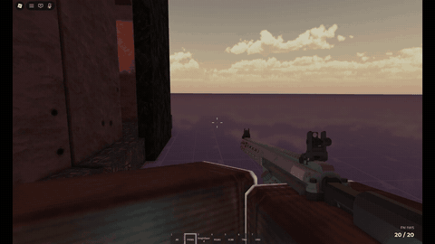

# Roblox Gun Framework

Gun system I made for Roblox. Works on R6 and R15, the server checks every shot, and new guns are just a config file + a Tool model.

[Full video](https://github.com/codext4fn-afk/roblox-gun-framework/raw/main/docs/showcase.mp4) (58 MB)

## What it does

- Hitscan with client prediction, the server re-raycasts + validates everything (origin, line of sight, fire rate, spread cone, ammo, reload state)
- 6 guns: AK, M16A1, SCAR, FNIWS, TRex, URGI
- Third person ADS w/ shoulder swap, first person sights, scope overlay
- Procedural recoil, sway, walk bob, sprint carry, wall obstruction
- R15 arm IK so the hands stay on the gun at any angle
- Reloads (straight / rock-in / bolt feed, mag taps, charging handle) all timed from config
- Pooled tracers, flashes, impacts, bullet holes, casings
- Keyboard, controller and mobile

Made by Fahd (Roblox: XXmello_iceXX). Portfolio only, not for reuse.
